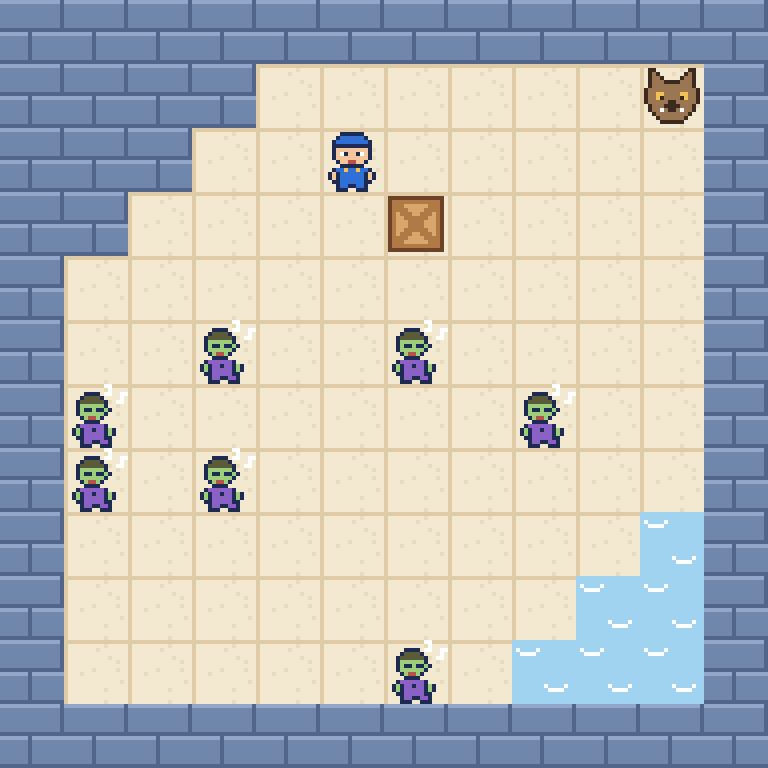

# Armas Insólitas

Es de noche y el almacén se ha llenado de zombis y hombres lobo. Para limpiarlo solo tienes siete armas muy poco
convencionales: una pistola-serpiente, una pistola de agua, un soplador de hojas, un lanzachuletas, una palanca, un
lanzacajas y una pistola del cambiazo (las cinco últimas, novedad de esta versión). Niveles
propios, cada uno con su mínimo demostrado con las reglas del propio juego. Juego web autónomo en **PuzzleScript Next**.

## Cómo se juega
- **Objetivo:** acabar con todos los monstruos y seguir vivo.
- **Flechas:** si no miras hacia ahí, te giras; si ya miras, avanzas. **X / espacio:** disparar (en el móvil, **dos toques seguidos sobre el mozo**). **Z:** deshacer · **R:** reiniciar.
- **Zombis:** duermen, pero si te pones a su lado te muerden. Saben nadar.
- **Hombres lobo:** ven en línea recta (también a través del agua), cargan hasta chocar y se comen lo que pillan; prefieren zombis y se ahogan en el agua.
- **Pistola-serpiente:** un disparo; la serpiente avanza recta comiéndose monstruos (¡y a ti!) hasta chocar, y luego la diriges: cada flecha la lanza hasta que vuelve a chocar; su cuerpo es muro; mientras avanza, tú retrocedes casilla a casilla hasta chocar, y tu rastro también es cuerpo.
- **Pistola de agua:** cada disparo alarga el chorro; ahoga lobos (y a ti), hunde cajas y arrastra zombis.
- **Soplador:** sopla en línea recta y lo primero que encuentra se mueve una casilla.
- **Lanzachuletas:** la chuleta vuela recta y cae justo antes de chocar; los hombres lobo la prefieren a ti, cargan a por ella y se quedan donde estaba. Solo una en juego: si nadie se la come, se recoge pisándola.
- **Palanca:** con una caja justo delante, tira de ella: tú retrocedes una casilla y la caja pasa a la tuya.
- **Lanzacajas:** lanza una caja que vuela recta y cae justo antes de chocar (en el agua, se hunde); la cifra del muro es la munición.
- **Cambiazo:** lanza un rayo recto; si da en una caja o en un zombi dormido, os cambiáis de sitio.

## Niveles
1. Primer disparo: mínimo 12 pasos
2. Desde dónde disparar: mínimo 16 pasos
3. Lobos al acecho: mínimo 20 pasos
4. La gran serpiente: mínimo 31 pasos
5. Hombre al agua: mínimo 10 pasos
6. Caja a pique: mínimo 7 pasos
7. Chorro a chorro: mínimo 11 pasos
8. Marea alta: mínimo 20 pasos
9. Un soplido: mínimo 6 pasos
10. Escudo y cebo: mínimo 18 pasos
11. Huracán: mínimo 24 pasos
12. Viento a favor: mínimo 32 pasos
13. Carne de cañón: mínimo 11 pasos
14. Todo en cadena: mínimo 12 pasos
15. La chuleta olvidada: mínimo 16 pasos
16. Festín: mínimo 13 pasos
17. La caja escudo: mínimo 14 pasos
18. Dos de una tacada: mínimo 15 pasos
19. Tú de cebo: mínimo 15 pasos
20. Tres tiros: mínimo 15 pasos
21. Barbacoa: mínimo 23 pasos
22. Recoger y repartir: mínimo 24 pasos
23. A cenar, chuchos: mínimo 25 pasos
24. La última cena: mínimo 28 pasos
25. Primer tirón: mínimo 9 pasos
26. Tira y empuja: mínimo 20 pasos
27. ¿Quién se lo come?: mínimo 22 pasos
28. Mudanza: mínimo 30 pasos
29. Una caja de la nada: mínimo 15 pasos
30. La primera, de tope: mínimo 17 pasos
31. Escudo y empujón: mínimo 20 pasos
32. Doble chapuzón: mínimo 24 pasos
33. La caja de atrás: mínimo 13 pasos
34. Saltar la mirada: mínimo 12 pasos
35. Fuera del rincón: mínimo 17 pasos
36. El trilero: mínimo 25 pasos
37. A través del charco: mínimo 25 pasos
38. Tres tirones: mínimo 30 pasos
39. Que venga la caja: mínimo 26 pasos
40. Donde acaba la cena: mínimo 28 pasos
41. En seco y a flote: mínimo 26 pasos
42. A la vista: mínimo 25 pasos
43. Ida y vuelta: mínimo 25 pasos
44. Las dos orillas: mínimo 28 pasos
45. Segundo plato: mínimo 36 pasos
46. La noria: mínimo 28 pasos
47. A flote: mínimo 28 pasos
48. Zigzag: mínimo 27 pasos
49. Las dos del callejón: mínimo 42 pasos
50. Donde choca: mínimo 25 pasos

## Créditos
- Niveles, soplador, lanzachuletas, palanca, lanzacajas, cambiazo, arte 16-bit y tarjetas: **Spider** (Fali + Claude), 2026
- Juego original: *Unconventional Guns*, de **rectangular Tim** (Ludum Dare 32, galería de PuzzleScript)
- Motor: [PuzzleScript Next](https://github.com/david-pfx/PuzzleScriptNext), incrustado en un único `index.html`
- Fuente del juego: [`juego.txt`](juego.txt)
